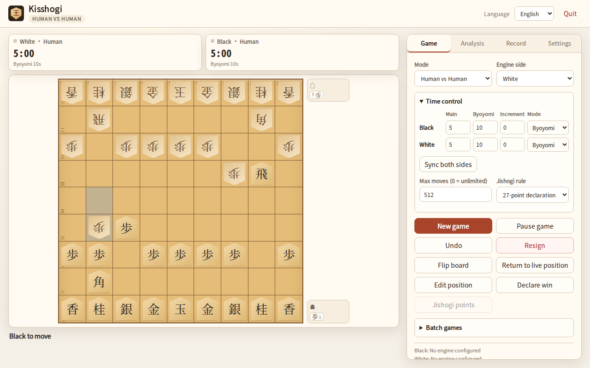

# Kisshogi

[English](README.md) · [简体中文](README.zh-CN.md)

Kisshogi は KISS 方針の小さな将棋 GUI です。ローカル対局と USI エンジンの
テスト向けに作られています。



## 機能

- 人 vs 人、人 vs エンジン、エンジン vs エンジン。
- **先手・後手で別々のエンジン**を設定可能。USI オプションを動的に全表示
  （check/spin/combo/string/filename/button）。
- **USI_Ponder** 対応（`go ponder` / `ponderhit` / `stop`）。
- 各側で独立した時間設定：持ち時間＋秒読み、または持ち時間＋フィッシャー加算。
- エンジン解析（MultiPV、リアルタイム info、全局解析、SVG 評価値グラフ）。
  停止後も最後の結果を保持し、ミニ盤で最善手を表示してそのまま盤面に指せます。
- 対局の一時停止／再開。時計は止まります。
- 伝統的な右側の駒台、4 種類のテーマ、画面に合わせた盤面サイズ。
- 設定画面にローカル設定ファイルのパスを表示。
- KIF / KI2 / CSA 読み込み、KIF / KI2 / CSA / SFEN 出力（UTF-8 / Shift_JIS）。
- 局面編集（盤面、持ち駒、手番、SFEN）。
- 入玉宣言（24/27点法）、24点法の持将棋判定。
- 連続対局（先後入替、開始 SFEN ローテーション、集計、CSV 出力）。
- 简体中文 / English / 日本語。ローカルフォントのみ、CDN 不使用。
- 最大手数を設定可能（0 = 無制限）。
- pywebview が使える場合はネイティブウィンドウ、失敗時はブラウザへフォールバック。

## インストール

必ず仮想環境を使い、システム Python に pip しないでください。

Linux ネイティブ:

```bash
sudo apt install python3-gi gir1.2-webkit2-4.1
python3 -m venv --system-site-packages .venv
source .venv/bin/activate
python -m pip install -U pip
pip install -e '.[native]'
kisshogi
```

Linux ブラウザのみ:

```bash
python3 -m venv .venv
source .venv/bin/activate
pip install -e .
kisshogi --browser
```

Windows PowerShell:

```powershell
py -3 -m venv .venv
.venv\Scripts\Activate.ps1
python -m pip install -U pip
pip install -e ".[native]"
kisshogi
```

ネイティブウィンドウを起動できない場合はブラウザへ自動フォールバックします。
`--native` は強制指定で、失敗時は依存関係の案内を表示します。
Linux のネイティブウィンドウは既定でソフトウェア OpenGL を使うため、VM や
リモートデスクトップでも動作します。`LIBGL_ALWAYS_SOFTWARE=0` で無効にできます。

## 起動と終了

```text
kisshogi                  # ネイティブ、失敗時ブラウザ
kisshogi --browser        # ブラウザ
kisshogi --native         # ネイティブ必須
```

ネイティブウィンドウを閉じると終了します。ブラウザモードではタブを閉じて
約5秒後に終了し、心拍のフォールバックで最大120秒後に終了します。
「終了」ボタンは即時終了、ターミナルの `Ctrl+C` も有効です。

## エンジン設定

1. 「設定」を開く。
2. 先手・後手・解析エンジンのパスを入力。相対パスは設定ディレクトリ基準、
   絶対パスも使用可能。
3. 「オプション読込 / テスト」を押すと、一時起動して `isready` を確認し、
   すべての USI オプションを表示します。
4. オプションを編集。button 以外は「エンジン再起動」で保存済みオプションを使って
   再起動すると反映されます。button は即時実行。
5. モードを選び「新規対局」。

エンジンのパスとオプションはローカル設定にのみ保存され、リポジトリや配布物には
含まれません。エンジンは同梱しません。

`USI_Ponder` は通常のオプションです。`true` にすると `go ponder` を送り、
予測手が指されたら `ponderhit`、外れたら `stop` を送ります。
Ponder の時間は持ち時間に加算されません。一括対局でも同じ Ponder 処理を使用します。

## 注意

- ルール、SFEN、KIF/CSA には独立した MIT ライブラリ tsshogi を使用しています。
- KIF/KI2/CSA の出力は既定で UTF-8、Shift_JIS も選択可能です。
- 最大手数は引き分け規則であり、GUI の制限ではありません。0 で無効。
- 連続対局では先手スロットをエンジン A、後手スロットをエンジン B として
  先後を入れ替えます。

## ライセンス

コード MIT、オリジナル視覚素材/CSS 駒/アイコン/スクリーンショット CC0-1.0、
tsshogi MIT、Noto CJK サブセット OFL-1.1、pywebview（任意）BSD 3-Clause。
詳細は [THIRD_PARTY_LICENSES.md](THIRD_PARTY_LICENSES.md) と
[ASSETS.md](ASSETS.md) を参照。
