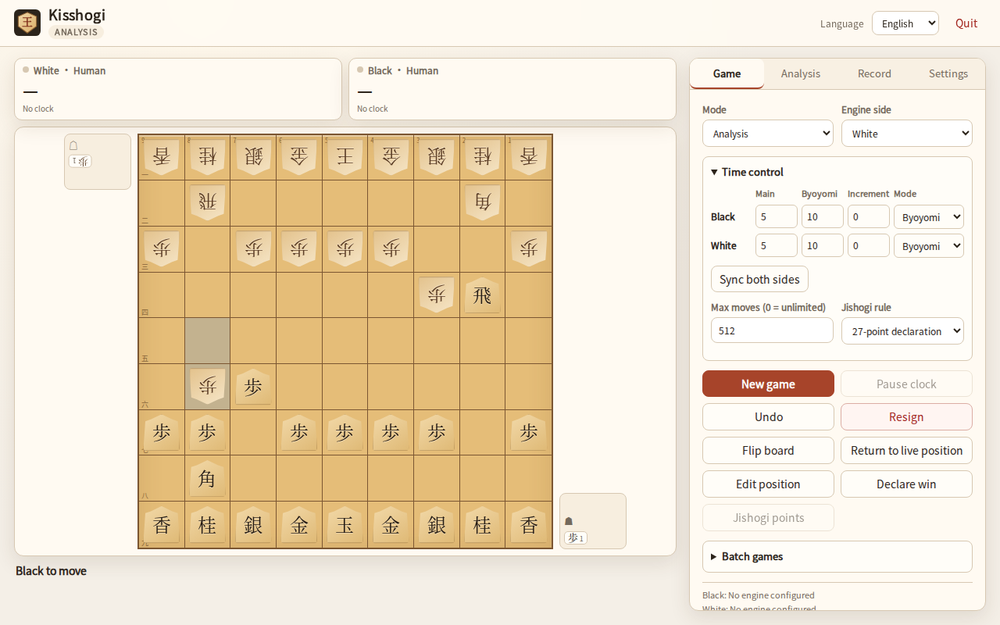

# Kisshogi

[简体中文](README.zh-CN.md) · [日本語](README.ja.md)

Kisshogi is a small, KISS shogi GUI for Windows and Linux, built for local
play and USI engine testing.



## Features

- Human vs Human, Human vs Engine, and Engine vs Engine.
- **Separate engines for Black and White**, with every USI option exposed in a
  dynamic form (check / spin / combo / string / filename / button).
- **USI_Ponder** support (`go ponder` → `ponderhit` / `stop`).
- Per-side time controls: main time + byoyomi **or** main time + Fischer
  increment. Each side can use a different mode.
- Engine analysis with MultiPV, live info, full-game scan, and an SVG
  evaluation graph. Analysis keeps its last output after stopping, shows the
  best move on a mini board, and can play that move onto the main board.
- Pause and resume a game without resetting the clocks.
- Hand trays on each player's right side (white left, black right) and four
  UI themes.
- The settings panel shows the local configuration file path.
- KIF / KI2 / CSA import; UTF-8/Shift_JIS input; KIF / KI2 / CSA / SFEN export
  in UTF-8 or Shift_JIS.
- Position editor (board, hands, side to move, SFEN).
- Entering-king declaration (24/27-point rules) and 24-point jishogi
  adjudication.
- Batch games with color swapping, start-SFEN cycling, result summary, and CSV
  export.
- Simplified Chinese, English, and Japanese UI; local fonts; no CDN.
- Configurable maximum move count (`0` = unlimited).
- Native window by default when pywebview is available; automatic browser
  fallback.

## Requirements

- Python 3.10+.
- Windows 10/11 or a modern Linux desktop.
- Native window (optional but recommended):
  - Windows: Edge WebView2 Runtime.
  - Linux: PyGObject + WebKitGTK 4.1.
- A USI engine of your choice. **No engine is bundled.**

## Install from source

Always use a virtual environment; do not install with the system Python.

Linux native window:

```bash
sudo apt install python3-gi gir1.2-webkit2-4.1
python3 -m venv --system-site-packages .venv
source .venv/bin/activate
python -m pip install -U pip
pip install -e '.[native]'
kisshogi
```

Linux without native dependencies (browser fallback):

```bash
python3 -m venv .venv
source .venv/bin/activate
pip install -e .
kisshogi --browser
```

Windows PowerShell:

```powershell
py -3 -m venv .venv
.venv\Scripts\Activate.ps1
python -m pip install -U pip
pip install -e ".[native]"
kisshogi
```

If the native window cannot start, Kisshogi falls back to the system browser.
`--native` forces native mode and fails with installation hints instead of
falling back. On Linux the native window uses software OpenGL by default so
WebKitGTK also works in VMs and remote desktops; set `LIBGL_ALWAYS_SOFTWARE=0`
to opt out.

## Prebuilt binaries

The GitHub release binaries include pywebview and try the **native window
first**, then fall back to the browser. On Linux the native window uses the
system PyGObject and WebKitGTK 4.1 libraries; the Linux binary is built on
Ubuntu 24.04, so older distributions should install from source. On Windows it
uses the WebView2 runtime.

## Run

```text
kisshogi                  # native window, fallback to browser
kisshogi --browser        # force browser
kisshogi --native         # require native window
```

Closing the native window exits Kisshogi. In browser mode, closing the tab
schedules an exit after about 5 seconds; a heartbeat fallback exits after
120 seconds if close detection fails. The header's **Quit** button exits
immediately. `Ctrl+C` in the terminal always works.

## Engine setup

1. Open **Settings**.
2. Enter the path to a USI engine for Black, White, and/or Analysis. Relative
   paths are resolved against the local config directory; absolute paths are
   also accepted.
3. Click **Read options / test**. Kisshogi starts the engine briefly, verifies
   `isready`, and lists every USI option.
4. Edit the options. Non-button changes take effect when you press
   **Restart engine**, which stops and starts the engine with the saved
   options; button options can be executed immediately.
5. Select a mode and press **New game**.

Engine paths and options are stored only in the local user config
(`%APPDATA%\Kisshogi\config.json` on Windows, `$XDG_CONFIG_HOME/kisshogi` or
`~/.config/kisshogi` on Linux). They are never written into the repository or
release artifacts.

`USI_Ponder` is just another option. Set it to `true` if the engine supports
pondering. Kisshogi sends `go ponder`, then `ponderhit` when the predicted move
is played, or `stop` on a mismatch. Ponder time is not charged to the clock.
Batch games use the same ponder flow when `USI_Ponder` is enabled.

## Notes

- Rules, SFEN, and KIF/CSA parsing use the independent MIT-licensed
  [tsshogi](https://github.com/sunfish-shogi/tsshogi) library.
- KIF/KI2/CSA export is UTF-8 by default; Shift_JIS is available from the
  export dialog. Shift_JIS export fails gracefully if a character cannot be
  encoded.
- The maximum move count is a draw rule, not a hard GUI limit. Set it to `0`
  to disable it.
- Batch games use the Black and White engine slots as Engine A and Engine B;
  colors are swapped on alternate games.

## License and credits

- Code: MIT.
- Original visual design, CSS artwork, icons, and screenshots: CC0-1.0.
- tsshogi: MIT.
- Noto CJK font subsets: SIL OFL 1.1.
- pywebview (optional): BSD 3-Clause.

See [THIRD_PARTY_LICENSES.md](THIRD_PARTY_LICENSES.md) and
[ASSETS.md](ASSETS.md).
