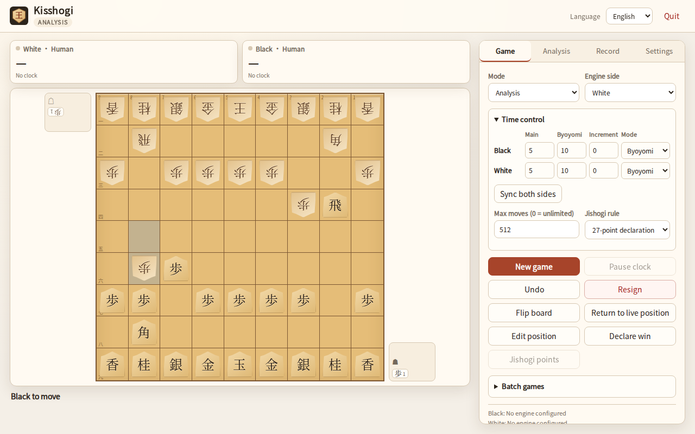

# Kisshogi

[English](README.md) · [日本語](README.ja.md)

Kisshogi 是一款遵循 KISS 原则的小型将棋 GUI，面向本地对局与 USI 引擎测试。



## 功能

- 人 vs 人、人 vs 引擎、引擎 vs 引擎。
- **黑白分别配置引擎**；动态展示全部 USI 选项（check/spin/combo/string/filename/button）。
- 支持 **USI_Ponder**（`go ponder`、`ponderhit`、`stop`）。
- 每方独立时间设置：主时间 + 秒読み，或主时间 + Fischer 增量；双方可用不同方式。
- 引擎分析（MultiPV、实时 info、整局解析、SVG 评估曲线）；停止后保留最后结果，
  小棋盘显示最佳着法，并可直接走到主棋盘。
- 暂停/恢复对局，计时不走。
- 白方驹台在左上、黑方在右下的传统布局；四种主题；棋盘大小自适应。
- 设置中显示本机配置文件路径。
- KIF/KI2/CSA 读取；KIF/KI2/CSA/SFEN 导出；支持 UTF-8 与 Shift_JIS。
- 局面编辑器（棋盘、持驹、手番、SFEN）。
- 入玉宣言（24/27 点）与 24 点持将棋判定。
- 批量对局（交换黑白、起始 SFEN 循环、汇总、CSV 导出）。
- 简体中文 / English / 日本語；本地字体，无 CDN。
- 最大手数可配置（0 = 不限）。
- 默认原生窗口（pywebview 可用时），失败自动回退浏览器。

## 从源码安装

请始终使用虚拟环境，不要用系统 Python 执行 pip。

Linux 原生窗口：

```bash
sudo apt install python3-gi gir1.2-webkit2-4.1
python3 -m venv --system-site-packages .venv
source .venv/bin/activate
python -m pip install -U pip
pip install -e '.[native]'
kisshogi
```

Linux 无原生依赖（浏览器回退）：

```bash
python3 -m venv .venv
source .venv/bin/activate
pip install -e .
kisshogi --browser
```

Windows PowerShell：

```powershell
py -3 -m venv .venv
.venv\Scripts\Activate.ps1
python -m pip install -U pip
pip install -e ".[native]"
kisshogi
```

原生窗口不可用时自动回退浏览器；`--native` 强制原生，失败会给出安装提示。
Linux 下原生窗口默认使用软件 OpenGL，以便在虚拟机和远程桌面上也能运行；可设置
`LIBGL_ALWAYS_SOFTWARE=0` 关闭。

GitHub Release 的二进制现在包含 pywebview，会优先打开原生窗口；Linux 使用系统
PyGObject/WebKitGTK 4.1（二进制在 Ubuntu 24.04 上构建，较旧的发行版请从源码安装），
Windows 使用 WebView2 运行时。

## 运行与退出

```text
kisshogi                  # 原生窗口，失败回退浏览器
kisshogi --browser        # 强制浏览器
kisshogi --native         # 强制原生窗口
```

关闭原生窗口即退出。浏览器模式下关闭标签页约 5 秒后退出；心跳兜底最多
120 秒。顶部“退出应用”立即退出；终端 `Ctrl+C` 始终有效。

## 引擎

1. 打开“设置”。
2. 填写黑方/白方/分析引擎路径。相对路径按配置目录解析，也可使用绝对路径。
3. 点击“读取选项 / 测试”，Kisshogi 会短暂启动引擎、验证 `isready` 并列出全部 USI 选项。
4. 修改选项。非 button 选项在点击“重启引擎”后生效（会用已保存的选项重启引擎）；
   button 选项可立即执行。
5. 选择模式并点击“新对局”。

引擎路径和选项只保存在本机配置中，不会写入仓库或发布物。项目不附带任何引擎。

`USI_Ponder` 就是普通选项；引擎支持时设为 `true`。Kisshogi 会发送
`go ponder`，预测着法命中时发送 `ponderhit`，否则发送 `stop`。Ponder 时间不计入棋钟。
批量对局也使用同一 Ponder 流程。

## 说明

- 规则、SFEN、KIF/CSA 使用独立 MIT 库 tsshogi。
- KIF/KI2/CSA 默认导出 UTF-8，也可选择 Shift_JIS；无法编码的字符会报错并提示改用 UTF-8。
- 最大手数是和棋规则，不是 GUI 硬限制；设为 0 可关闭。
- 批量对局把黑方槽作为引擎 A、白方槽作为引擎 B，交替交换黑白。

## 许可证与致谢

代码 MIT；原创视觉/CSS 棋子/图标/截图 CC0-1.0；tsshogi MIT；Noto CJK 子集
OFL-1.1；pywebview（可选）BSD 3-Clause。详见
[THIRD_PARTY_LICENSES.md](THIRD_PARTY_LICENSES.md) 与 [ASSETS.md](ASSETS.md)。
